# 家庭食谱清单

记录菜品的食材组成和切配形态，不记录炒菜流程。菜名优先沿用提供的名称；仅提供图片时，根据图片提炼简短名称。

| 菜品名       | 配料清单                           | 图片                                                                                                     | 日期         | 备注                         |
| --------- | ------------------------------ | ------------------------------------------------------------------------------------------------------ | ---------- | -------------------------- |
| 飞刀猪肉炒芹菜沫  | 姜丝 + 蒜片/蒜块 + 猪肉碎 + 芹菜末         | 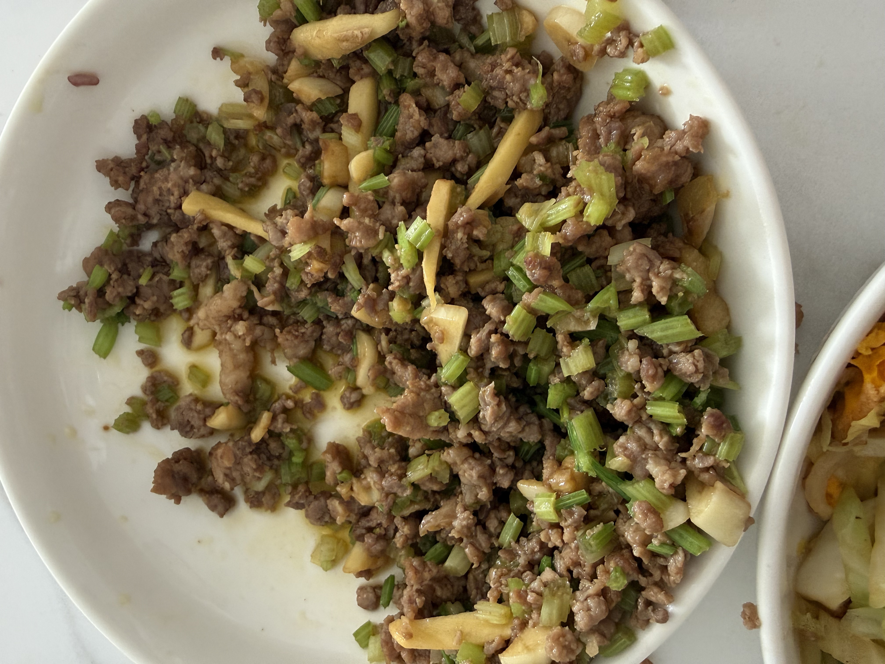 [查看原图](images/2026-10-26-001.jpg)  | 2026-10-26 | —                          |
| 包菜炒蛋      | 包菜丝 + 鸡蛋                       | 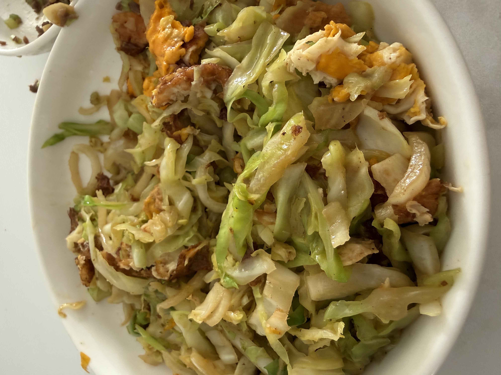 [查看原图](images/2026-10-26-002.jpg)      | 2026-10-26 | —                          |
| 猪耳炒青蒜（暂名） | 猪耳片 + 蒜片/蒜块                    | 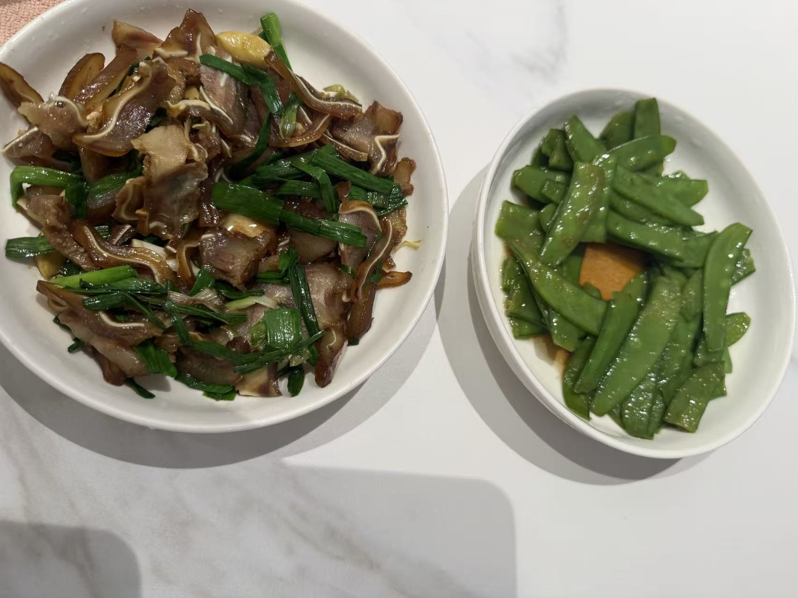 [查看原图](images/2026-10-26-003.jpg) | 2026-10-26 | 第二批图1左；绿色配菜疑似青蒜，待确认。       |
| 荷兰豆炒胡萝卜   | 荷兰豆 + 胡萝卜片                     |  [查看原图](images/2026-10-26-003.jpg)   | 2026-10-26 | 第二批图1右。                    |
| 姜片炖腊猪蹄    | 腊猪蹄块 + 姜片                      | 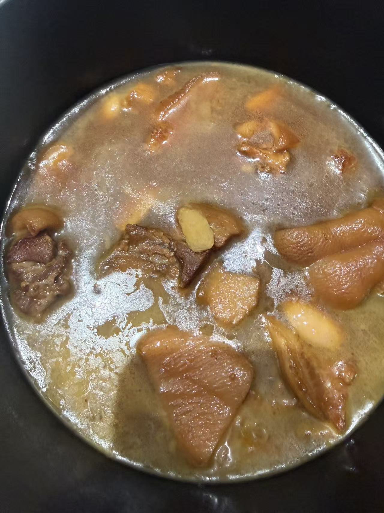 [查看原图](images/2026-10-26-004.jpg)    | 2026-10-26 | 第二批图2；用户确认主料为腊猪蹄。          |
| 豌豆炒肉末     | 豌豆 + 肉末 + 蒜片                   | 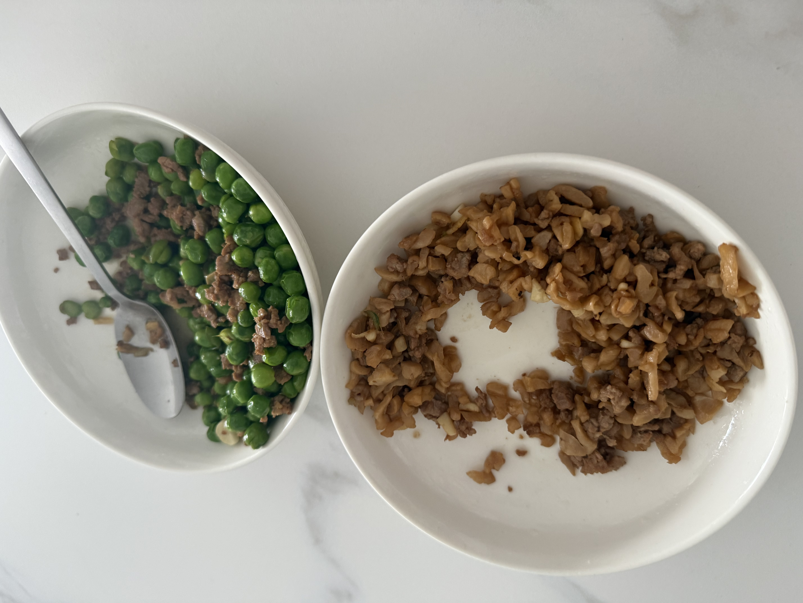 [查看原图](images/2026-10-26-005.jpg)     | 2026-10-26 | 第二批图3上；肉类品种未确认。            |
| 萝卜丁炒肉末    | 萝卜丁（萝卜干切碎） + 肉末 + 蒜片/蒜块        |  [查看原图](images/2026-10-26-005.jpg)    | 2026-10-26 | 第二批图3下；用户确认配菜为萝卜干，切碎记为萝卜丁。 |
| 包菜肉片炒蛋    | 包菜块 + 鸡蛋 + 肉片                  | 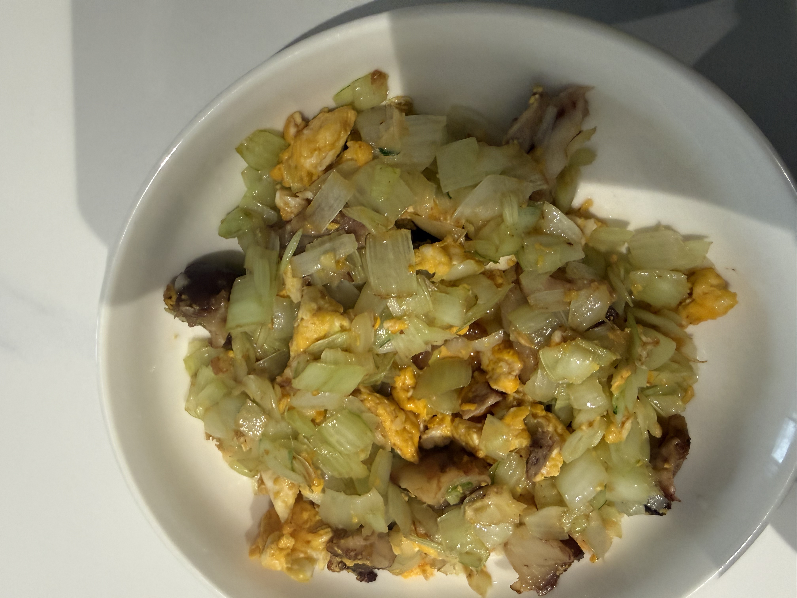 [查看原图](images/2026-10-26-006.jpg)    | 2026-10-26 | 第二批图4；肉片疑似腊肉，待确认。          |
| 笋片炖肉      | 笋片 + 带皮肉片                      | 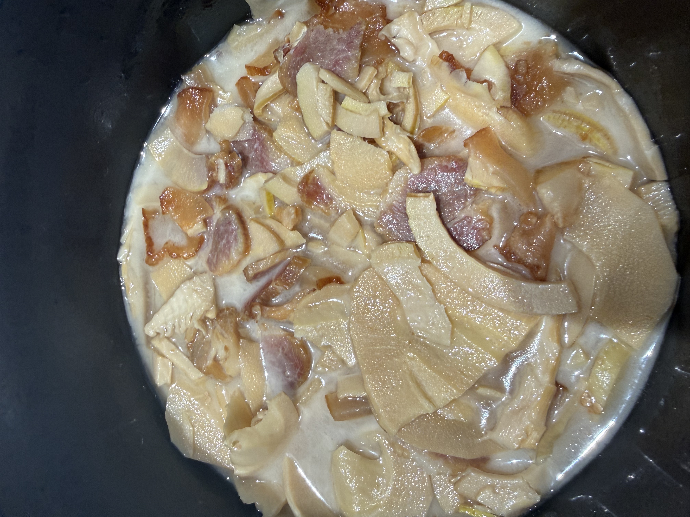 [查看原图](images/2026-10-26-007.jpg)      | 2026-10-26 | 第二批图5；肉片疑似腊肉，待确认。          |
| 青椒炒肉片     | 青辣椒圈 + 肉片 + 姜丝 + 蒜片/蒜块         | 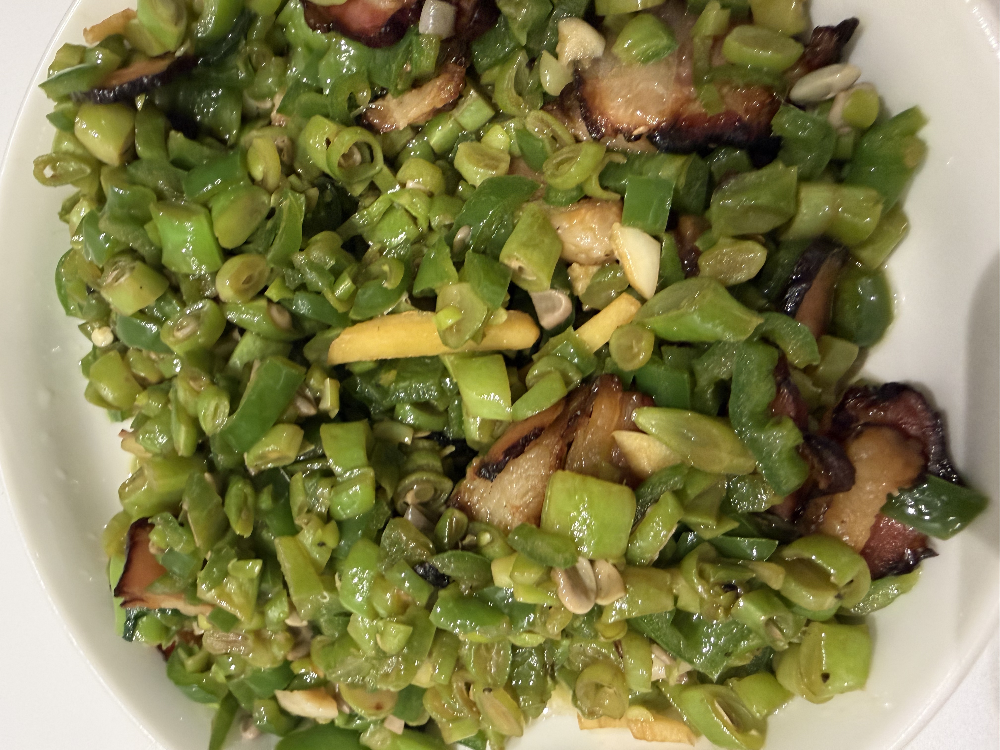 [查看原图](images/2026-10-26-008.jpg)     | 2026-10-26 | 第二批图6；肉片疑似腊肉，待确认。          |
| 腐竹木耳      | 腐竹条 + 黑木耳 + 姜片                 | 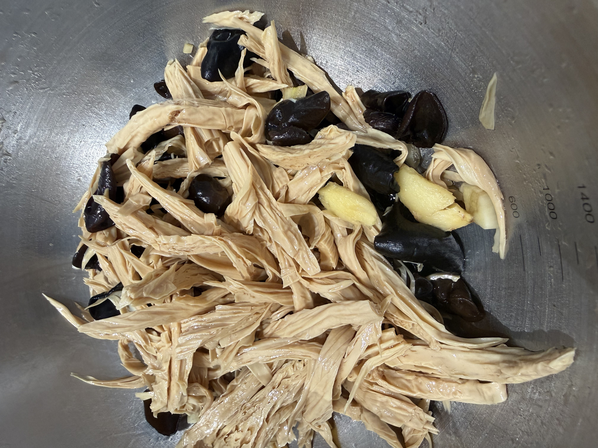 [查看原图](images/2026-10-26-009.jpg)      | 2026-10-26 | 第二批图7。                     |
| 青椒粉条      | 粉条 + 青椒圈/段 + 蒜片                | 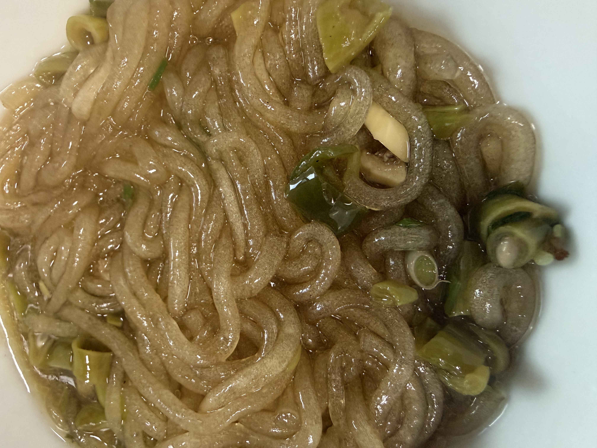 [查看原图](images/2026-10-26-010.jpg)      | 2026-10-26 | 第二批图8；粉条原料、辣椒是否腌制未确认。      |
| 鸡块鸡爪      | 鸡块（含鸡翅） + 鸡爪 + 姜片/姜丝 + 青椒 + 红椒 | 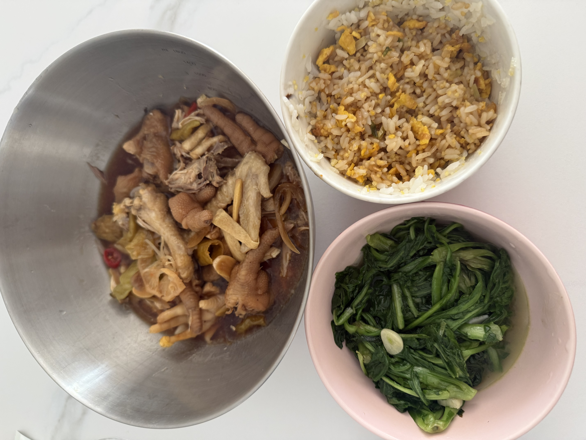 [查看原图](images/2026-10-26-011.jpg)      | 2026-10-26 | 第二批图9上；浅色条片状配菜待确认。         |
| 蒜片青菜      | 青菜 + 蒜片                        |  [查看原图](images/2026-10-26-011.jpg)      | 2026-10-26 | 第二批图9左下；青菜具体品种待确认。         |
| 红枣炖鸡      | 鸡块 + 红枣 + 蘑菇片                  | 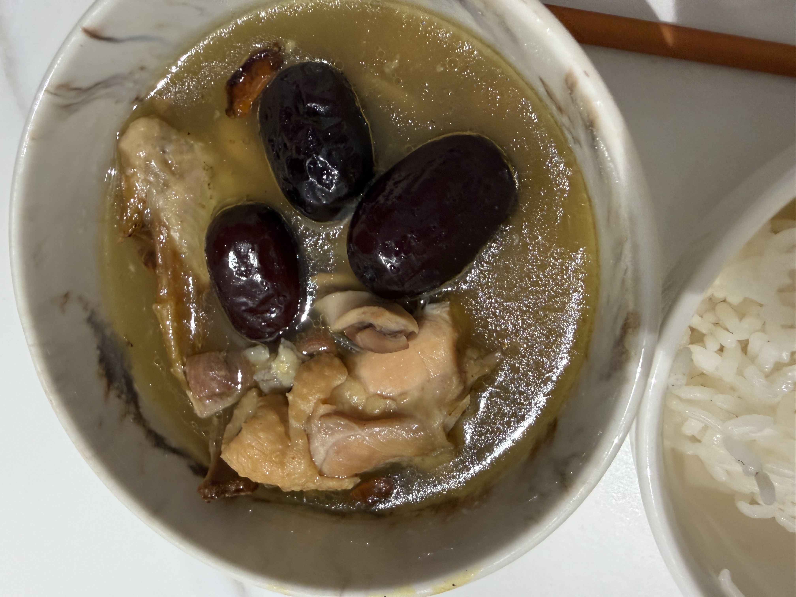 [查看原图](images/2026-10-26-012.jpg)      | 2026-10-26 | 第三批图1；菜名由用户提供，蘑菇具体品种未确认。   |
| 腊肉蒜苗炒肉    | 腊肉片 + 蒜苗段 + 青椒丝/圈              | 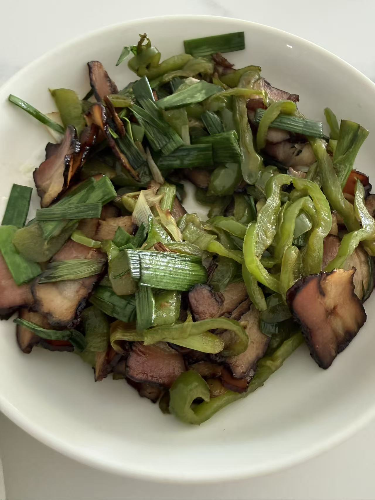 [查看原图](images/2026-10-26-013.jpg)    | 2026-10-26 | 第三批图2；菜名沿用用户原文。            |
| 爆炒鳝鱼丝     | 鳝鱼丝 + 青椒段 + 红椒段 + 姜丝 + 蒜片      | 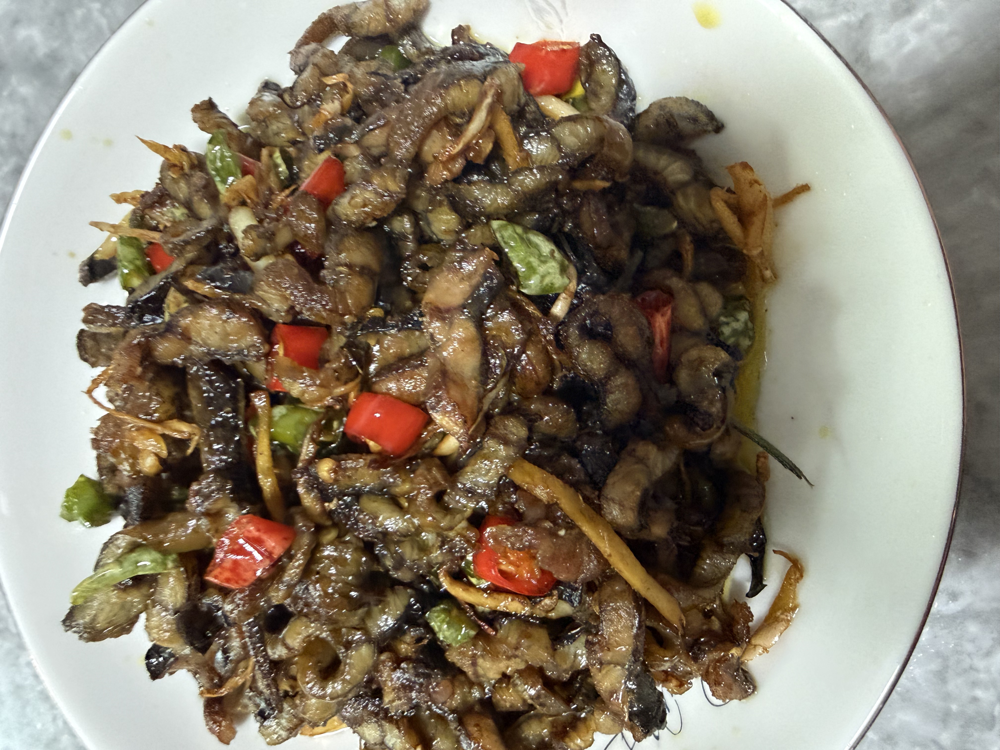 [查看原图](images/2026-10-26-014.jpg)     | 2026-10-26 | 第三批图3；菜名由用户提供。             |
| 爆炒牛蛙      | 牛蛙块 + 姜片/姜丝                    | 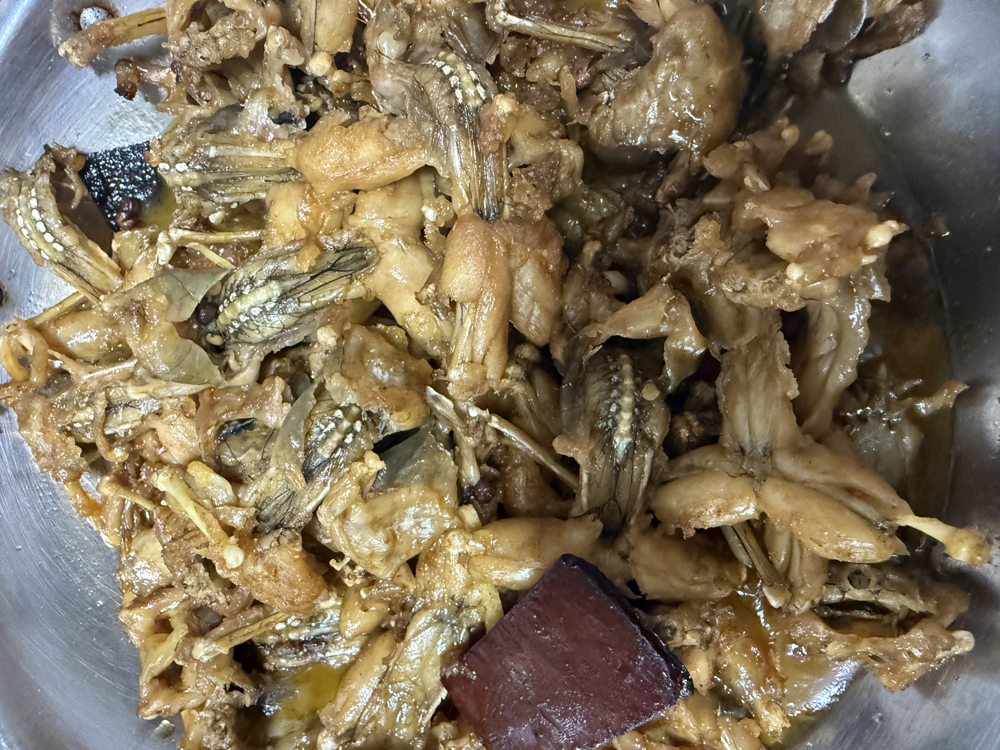 [查看原图](images/2026-10-26-015.jpg)      | 2026-10-26 | 第三批图4；深红色块状配菜及部分颗粒状配料待确认。  |
| 清蒸鲈鱼      | 鲈鱼 + 姜丝/姜片 + 葱段 + 蒜瓣           | 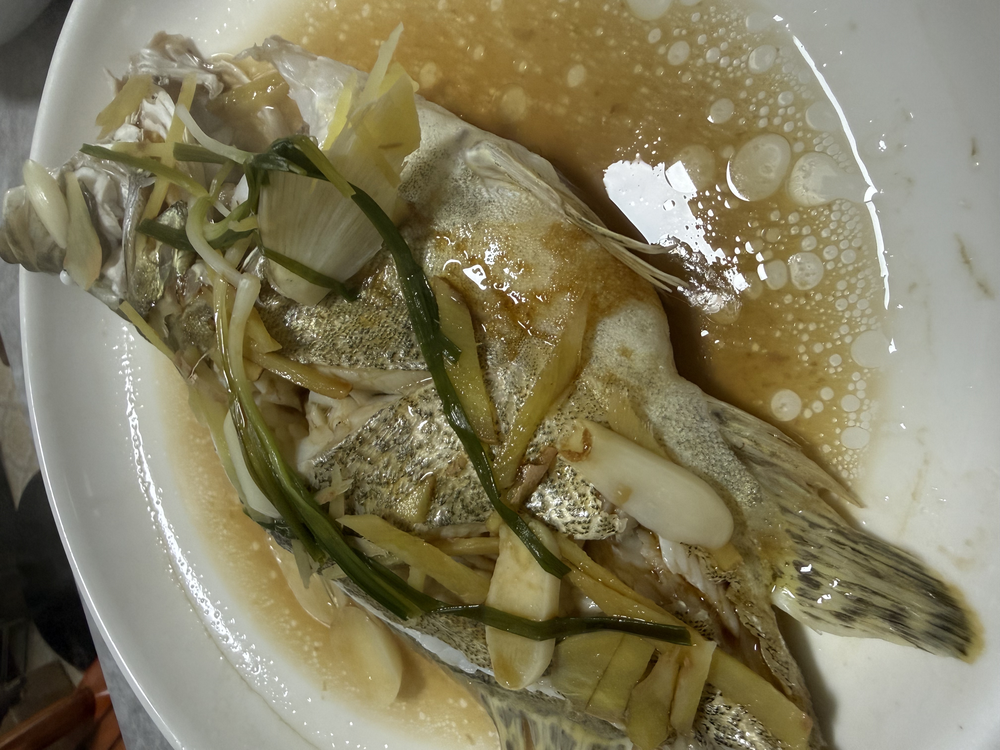 [查看原图](images/2026-10-26-016.jpg)      | 2026-10-26 | 第三批图5；菜名由用户提供。             |

## 记录说明

- 日期为提供菜品的日期；本次为 2026-10-26（Asia/Dubai），不使用照片拍摄时间。
- 图1可见蒜片、蒜块和粗细不一的猪肉碎，按图片形态记录。菜名中的“芹菜沫”沿用提供的写法。
- 图2可确认包菜和鸡蛋，其他无法辨认的配料不补写。油、盐、酱油等调味料及食材用量，需明确提供后再补充。
- 后续记录统一维护在本表，原图保存在 `images/`。仅提供文字时，图片栏填“—”；同一道菜在不同日期提供时追加一条记录，以保留历史。

## 2026-10-26 第二批图片记录

- 本批收到10张图片；图9与图10为同一张照片，只保存一份，不重复建条目。新增9张原图、13条菜品记录，本批追加后共15条记录、11张原图。
- 本批图1至图9依次对应 `images/2026-10-26-003.jpg` 至 `images/2026-10-26-011.jpg`；同一张原图中的多道菜分别记录，共用原图，在备注中标明位置。
- 配料清单仅包含用户明确提供或图片可辨认的食材；疑似配料写入备注，待确认后补全。
- 上方“记录说明”中的图1、图2指首批图片；后续表格备注用批次和图号区分图片。

## 2026-10-26 第三批图片记录

- 本批按用户提供的名称新增5条菜品记录和5张原图；本批追加后共20条记录、16张原图。
- 第三批图1至图5依次对应 `images/2026-10-26-012.jpg` 至 `images/2026-10-26-016.jpg`。
- 同时根据用户确认，将第二批图2更正为“姜片炖腊猪蹄”，第二批图3下盘更正为“萝卜丁炒肉末”，保留原日期及图片。
